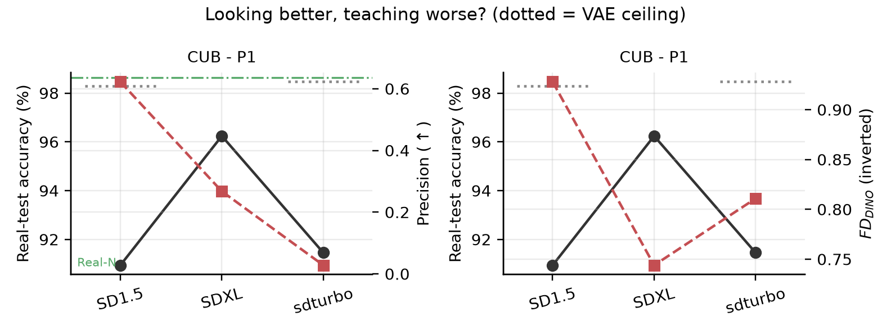
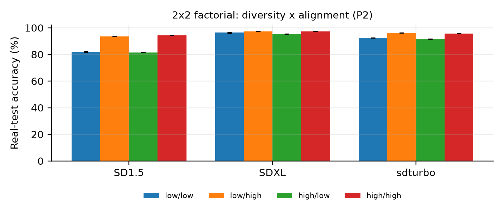
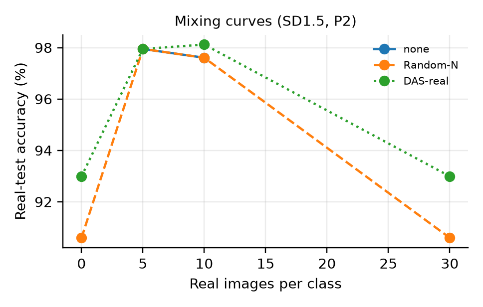

# Do Better Generators Make Worse Teachers? A Compute-Limited Pilot on 20 CUB Classes

Authors: [to be added]

**Status: pilot study / working draft.** This is a small, honestly scoped study run on free GPUs. It is not a full-scale replication of the original design, and it should not be submitted as one without the extensions listed in Section 6.

## Abstract

Text-to-image models are widely used to create training data, and newer generators produce images that look better. Do they also teach better? We ask which measurable property of a synthetic training set (diversity, coverage, label alignment, fidelity) explains real-test accuracy. We hold the prompt and image pool fixed and build equal-sized training sets that differ in one property. Because of a hard compute limit (free Kaggle T4 GPUs), this pilot covers only 20 evenly spaced classes of CUB-200-2011, three open generators (SD1.5, SD-Turbo, SDXL), two prompt styles and one generation seed. A linear probe on frozen DINOv2 features trained on 480 synthetic images per generator reaches 90.9% (SD1.5), 91.5% (SD-Turbo) and 96.2% (SDXL) on real test images, against 98.6% for real data. **In this pilot the newer, larger generator is the better teacher; we do not observe the hypothesised inversion.** Within a generator, label alignment is the property that matters (+12.2 points for SD1.5, +1.3 for SDXL), while diversity has almost no effect. A training-free selection rule that filters by alignment and then spreads samples out (DAS) improves over random selection by 1.2 to 3.4 points, but a plain alignment filter does about as well. Most differences are only a few test images; we report them with that caveat.

## 1. Introduction

Synthetic images from text-to-image diffusion models are a cheap way to build classifiers when real data is scarce. A common assumption is that a generator which looks more realistic is a better teacher. This assumption is rarely tested directly, because generators differ in many ways at once. We try to isolate what matters by *intervening*: for one generator and one prompt, we build training sets of the same size that differ only in one measured property of the images, then compare the accuracy of a classifier trained on each.

The original design of this project covers four generators, two datasets and three generation seeds (about 600,000 images, around 600 A100 GPU-hours). We could not run that. This report describes what a compute-limited version found, and is explicit about what that version can and cannot say.

**Contributions.** (i) An open implementation of the full pipeline (generation, measurements, factorial and subset designs, selection rules), run end to end on real data. (ii) A pilot-scale answer to the title question on three generators. (iii) Evidence that, within a generator, label alignment dominates diversity as a lever, and that the four properties are too collinear to be separated by a regression. (iv) A clear list of what must be scaled up before any strong claim is made.

## 2. Setup

### 2.1 Data

CUB-200-2011 (200 bird species). To fit our budget we use 20 classes chosen deterministically at evenly spaced class indices (no hand-picking). Each class has 24 real training images, 5 further training images per class are held out only to score label alignment (the 'alignment split'), and 585 real test images in total are used for evaluation. One test image is worth 0.17 percentage points.

### 2.2 Generators and prompts

**SD1.5** (512px, 25 steps, guidance 2.0), **SD-Turbo** (512px, 4 steps, no guidance; an adversarially distilled model, so a faster model, not simply a newer SD1.5), and **SDXL** (rendered at 768px rather than its native 1024px, 25 steps, guidance 2.0; this was needed to fit a 15 GB T4 GPU and the session time limit). Resolution, step count and guidance therefore differ across generators, and they are confounded with the generator itself. Prompt **P1** is one fixed template ("a photo of a {class}, a type of bird"). Prompt **P2** uses templates that vary pose, background, lighting, season and viewpoint. Each pool has 72 images per class (3 times the 24 real images), so 1,440 images, and equal-size training sets use 480 images (24 per class).

### 2.3 Measurements

Features come from DINOv2-base (used for the learner and all reported metrics) and CLIP ViT-L/14 (used only for selection and alignment, so selection cannot optimise the space it is scored in). Per class we compute Vendi score (diversity), k-NN coverage, improved precision/recall and density, and Frechet distance (FD_DINO). Label alignment is scored two ways: A_real, the probability of the prompted class under a nearest-class-mean classifier built from the 5-shot alignment split, and A_text, CLIP zero-shot probability from class names alone.

### 2.4 Learner

A frozen-feature linear (logistic regression) probe on DINOv2 features. Weight decay is chosen on a held-out 20% of the *synthetic* data, so no real validation data is used. The from-scratch ResNet control in the original design was not run.

### 2.5 Interventional designs and DAS

**2x2 factorial:** from the P2 pool we build equal-size sets that are low or high on diversity and low or high on alignment, and compare cells. **Random-subset design:** 150 balanced random subsets per generator (reduced from 500 for time), regressed on the four properties with a variance decomposition. **DAS** (diversity-matched, alignment-filtered sampling) first keeps the best-aligned images (top 60%, quantile 0.4) and then picks a spread-out subset with greedy k-center in CLIP space. Baselines are random selection, all 1,440 images (3x data), k-center only, alignment filter only, and real 5-shot data.

## 3. Results

### 3.1 Which generator teaches best?

| Generator | Prompt | Acc. (%) | Vendi | Coverage | Precision | Recall | FD_DINO | A_text |
|---|---|---|---|---|---|---|---|---|
| SD1.5 | P1 | 90.9 | 11.2 | 0.70 | 0.62 | 0.013 | 0.93 | 0.73 |
| SD1.5 | P2 | 90.6 | 14.3 | 0.68 | 0.79 | 0.008 | 1.10 | 0.62 |
| SD-Turbo | P1 | 91.5 | 4.6 | 0.03 | 0.03 | 0.015 | 0.81 | 0.89 |
| SD-Turbo | P2 | 93.8 | 8.5 | 0.25 | 0.18 | 0.021 | 0.93 | 0.77 |
| SDXL (768px) | P1 | 96.2 | 6.5 | 0.36 | 0.27 | 0.040 | 0.74 | 0.92 |
| SDXL (768px) | P2 | 95.9 | 9.0 | 0.58 | 0.47 | 0.042 | 0.83 | 0.86 |
| VAE ref. (SD1.5) | - | 98.3 | 5.2 | 1.00 | 0.98 | 1.00 | 0.11 | - |
| VAE ref. (SD-Turbo) | - | 98.5 | 5.2 | 1.00 | 0.98 | 1.00 | 0.11 | - |
| Real, 5 per class | - | 97.9 |  |  |  |  |  |  |
| Real, 10 per class | - | 97.6 |  |  |  |  |  |  |
| Real, all 24 per class | - | 98.6 |  |  |  |  |  |  |

*Table 1. Accuracy on real CUB test images of a probe trained on 480 images (random selection), plus fidelity/diversity measures. VAE ref. = real training images re-rendered through the generator's autoencoder (SDXL's was not run for memory reasons). One generation seed; one test image = 0.17 points.*

Under both prompts the order is SDXL, then SD-Turbo, then SD1.5 (P1: 96.2, 91.5, 90.9). The newest and largest generator is the best teacher here, so the hypothesised inversion (newer generators teach worse) is **not supported in this pilot**. SD-Turbo is not better than SD1.5 under P1 (91.5 vs 90.9 is about 3 test images), but is under P2 (93.8 vs 90.6). Re-rendering real images through the autoencoder gives 98.3 to 98.5%, essentially the real-data accuracy, so autoencoder artefacts are not what limits synthetic data. The ranking by FD_DINO (SDXL 0.74 best, SD-Turbo 0.81, SD1.5 0.93) matches the accuracy ranking, while improved precision does not: SD1.5 has the *highest* precision (0.62) but is the *worst* teacher. This is the one place where 'looks better, teaches worse' appears, and it rests on one measure at a small per-class sample size (precision and recall are computed over only 24 images per class and are noisy).

### 3.2 Alignment matters; diversity barely does

| Generator | Diversity effect | Alignment effect | Interaction | low div / low align | high div / high align |
|---|---|---|---|---|---|
| SD1.5 | +0.1 [-0.1, +0.3] | +12.2 [+12.1, +12.5] | +1.6 [+1.0, +1.9] | 82.1 | 94.4 |
| SD-Turbo | -0.7 [-0.7, -0.7] | +3.9 [+3.9, +3.9] | +0.3 [+0.3, +0.3] | 92.5 | 95.7 |
| SDXL (768px) | -0.5 [-0.7, -0.3] | +1.3 [+1.0, +1.4] | +0.9 [+0.7, +1.4] | 96.5 | 97.3 |

*Table 2. 2x2 factorial on the P2 pool, in accuracy points (95% interval over selection and training seeds, not over generation seeds). Cells use extreme quantile subsets, so they are not comparable to Table 1's random selection.*

Raising label alignment helps a lot for the weakest generator (+12.2 points for SD1.5), less for SD-Turbo (+3.9), and little for SDXL (+1.3). Raising diversity does nothing or slightly hurts (+0.1, -0.7, -0.5). A plausible reading is that a weaker generator often draws the wrong or an unrecognisable bird for a prompt, so filtering out those images helps a great deal, while SDXL already mostly draws the right bird. This is a hypothesis consistent with the data, not something we tested directly. The intervals are very narrow, but they only reflect selection and training randomness; with one pool per generator, the real uncertainty is larger than they suggest.

### 3.3 The four properties cannot be separated here

Across 150 random subsets per generator (450 in total), a regression on the four properties explains only **3.6%** of the variance in accuracy, and each property's share is at most 1.6%. The properties are strongly collinear: Vendi correlates 0.91 with coverage and 0.92 with precision, and variance inflation factors range from 36 to 147 (values above 10 are usually taken as serious). A between-generator version of the decomposition has only 3 data points and 4 predictors, so it is not identified (its R-squared of 1.0 is a mathematical artefact); **we do not interpret it**, and we do not report the 'share of accuracy explained by each property' that the original draft aimed for.

### 3.4 DAS and baselines

| Method | SD1.5 | SD-Turbo | SDXL |
|---|---|---|---|
| Random-N | 90.6 | 93.8 | 95.9 |
| All-mN (3x data) | 90.4 | 95.4 | 96.2 |
| k-center only | 88.5 | 92.5 | 96.6 |
| Filter only (A_text) | 91.6 | 96.2 | 97.3 |
| DAS-text | 94.0 | 95.0 | 97.1 |
| Filter only (A_real) | 90.6 | 95.2 | 97.3 |
| DAS-real | 93.0 | 95.9 | 97.1 |
| Real 5-shot + DAS-real | 97.9 | 98.5 | 97.6 |
| Real 5-shot (100 images) | 97.8 | 97.8 | 97.8 |
| Real, all (480 images) | 98.6 | 98.6 | 98.6 |

*Table 3. Real-test accuracy (%) for each selection method, 480 synthetic images unless stated, P2 pool. Real 5-shot appears as 97.9 in Table 1 and 97.8 here; they come from separate runs of the probe (one test image = 0.17 points).*

DAS-real improves over random selection by +2.4 (SD1.5), +2.1 (SD-Turbo) and +1.2 points (SDXL); DAS-text by +3.4, +1.2 and +1.2. It beats using all 1,440 images (three times the data) in 5 of 6 cases. But filtering by alignment alone is about as good: it is equal to or better than DAS in 3 of 6 cases (SD-Turbo with A_text, SDXL with both scorers), so **we cannot credit DAS's diversity step with an improvement**. The diversity-only baseline (k-center) is below random for two generators. Adding DAS-selected synthetic images to the 5-shot real set changes accuracy by -0.2 to +0.7 points relative to real 5-shot alone, which is within a few test images. Real data with only 5 images per class (97.8%) still beats every synthetic-only set.

### 3.5 Robustness checks and per-class effects

**Ablations.** Changing the alignment-filter threshold (keep top 80%, 60%, 40%) moves DAS accuracy by at most about 1 point for SD1.5 (93.0 to 93.3), SD-Turbo (95.0 to 96.1) and SDXL (96.4 to 97.4); a different first-centre rule gives similar accuracy. **Mixing with real data.** Once a class has 5 or 10 real images, adding synthetic images changes accuracy by between -0.5 and +0.9 points (up to about 5 test images), with no consistent direction. We cannot say where synthetic data stops helping, because real-only accuracy is already near ceiling (about 98%).

| Generator | Slope of gap on familiarity | 95% bootstrap CI | R-squared | p-value |
|---|---|---|---|---|
| SD1.5 | -0.29 | [-0.52, -0.05] | 0.16 | 0.0854 |
| SD-Turbo | -0.95 | [-1.32, 0.23] | 0.58 | 0.0001 |
| SDXL (768px) | -0.18 | [-0.24, 0.25] | 0.49 | 0.0006 |

*Table 4. Per-class gap (real-data accuracy minus synthetic-data accuracy) regressed on class familiarity (mean CLIP zero-shot probability of the class name on P1 images); 20 classes.*

In all three generators, classes the generator 'knows' poorly have larger accuracy gaps (negative slope). The relationship is strong for SD-Turbo (R-squared 0.58) and SDXL (0.49) and weak for SD1.5 (0.16, p = 0.085). With 20 classes and many classes at 100% accuracy, this is suggestive evidence only.

## 4. Discussion

The simple story 'better-looking generators teach worse' is not what we see: the best generator by FD, by accuracy and by label alignment is the same one (SDXL). What we do see is (a) a precision measure that disagrees with the others, (b) a large benefit from alignment filtering for the weak generator that shrinks as the generator improves, and (c) no sign that diversity, as measured here, is the bottleneck. Practically, for a weak generator, checking that each image shows the prompted class (with CLIP, for free) is the most useful thing to do before training.

## 5. Limitations (please read)

&bull; **Scale.** 20 classes of one dataset, three generators, one generation seed per pool, 585 test images. Intervals reflect selection/training randomness only. One test image is 0.17 points, so most differences in Table 3 are 1 to 6 images.

&bull; **Ceiling effect.** The 20 selected classes are easy: real data reaches 98.6%. This compresses differences and may hide effects visible on all 200 classes.

&bull; **Confounded generators.** SD1.5, SD-Turbo and SDXL differ in resolution (512 / 512 / 768), steps (25 / 4 / 25) and guidance, not just in model quality. SDXL was not run at native resolution. SD-Turbo is a distilled model, not a 'next version' of SD1.5.

&bull; **Old generators only.** SD3.5 and FLUX, which the original question is really about, were not run (they do not fit on free T4 GPUs).

&bull; **Reduced designs.** 150 random subsets instead of 500; the from-scratch ResNet control, the second dataset (FGVC-Aircraft), the oracle caption prompt (P3) and additional generation seeds were not run. SDXL's autoencoder reference was not run.

&bull; **Collinearity.** The four properties are too correlated to attribute accuracy to each; the between-generator decomposition has only three points.

&bull; **Metric noise.** Per-class precision/recall use 24 images per class and are noisy; SD-Turbo's P1 precision (0.03) and coverage (0.03) look unusually low and should be checked before being relied on.

## 6. What is needed for a full study

A full version needs all 200 CUB classes and FGVC-Aircraft, three generation seeds, at least one modern generator (SD3.5 or FLUX) at native resolution, and a consistent step/guidance budget. The code in the accompanying repository does this (about 200 A100 GPU-hours for one seed; see docs/COMPUTE_PLAN.md). We expect it to need a university or cloud allocation, which we did not have.

## 7. Reproducibility and responsible use

Code, configurations and all result tables: https://github.com/Star-alien/synthgap (a venue with double-blind review would need an anonymised copy). The pilot used the config files configs/exp/kaggle20.yaml and final20.yaml. Generation ran on free Kaggle Tesla T4 GPUs; analysis ran on a laptop. Generators are used under their own model licences; CUB-200-2011 is used under its research terms. No human-subject data were collected. All numbers in this report are produced by the code from the stored images; none were edited by hand.
